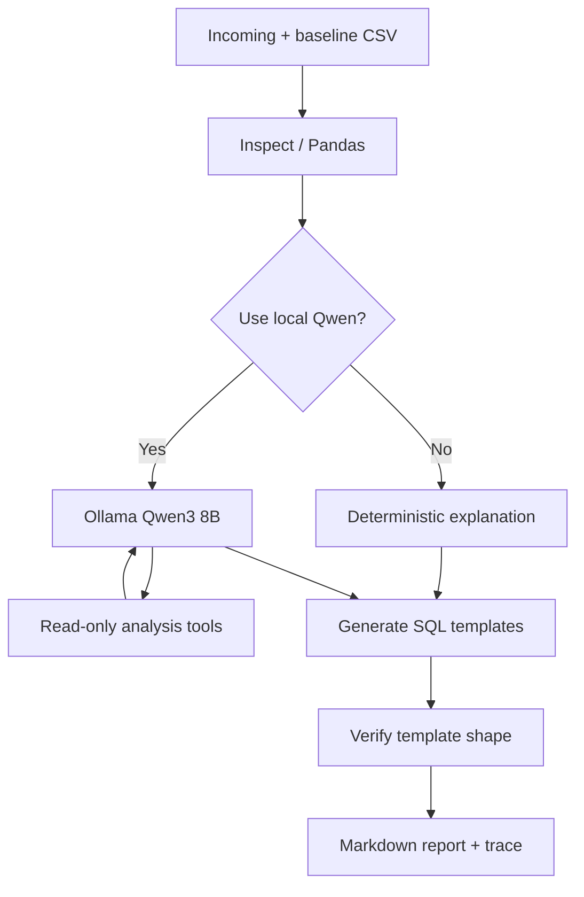

# SchemaGuard AI — LangGraph Data Quality Triage

**A local-first, evidence-based data quality investigation agent** for analytics and ML pipelines. Designed as a practical teaching/demo project for agent orchestration, tool calling, observability, and evaluation.

## What it demonstrates

- **Data profiling:** schemas, missing values, uniqueness, and invalid values using Pandas.
- **Rule-based anomaly detection:** compare incoming CSV data with a reference snapshot.
- **LangGraph:** `inspect → (deterministic | Ollama tool-calling) → generate SQL → verify SQL template → report`.
- **Model-directed tools:** Qwen3 8B can choose `get_quality_findings`, `get_column_profile`, and `get_baseline_evaluation`.
- **Observability:** download real execution stages and tool traces from the app; model failures remain visible.
- **Synthetic evaluation:** 20 deliberately corrupted cases + 20 clean control snapshots.
- **Public demo:** deterministic features run on free Streamlit Community Cloud; no paid API keys.

## Results (deterministic synthetic benchmark)

| Metric | Baseline result |
|---|---:|
| Injected corruption scenarios | 20 |
| Correctly detected scenarios | 18 |
| Case-level recall | 90% |
| Flagged clean control snapshots | 0 / 20 |

Two smaller null spikes are missed due to threshold choice. These are **rule-engine scores, not LLM accuracy**. The dataset is constructed for demonstration, so these do not predict real-world production performance. Re-run: `python scripts/export_benchmark.py`.

## Architecture



## Local installation

Use Python 3.12:

```bash
python3 -m venv .venv
source .venv/bin/activate
python -m pip install -r requirements.txt
python -m pytest -q
python -m streamlit run app.py
```

Optional LLM mode: install [Ollama](https://ollama.com/download), run `ollama pull qwen3:8b`, start the Ollama server/app, then toggle the local model on in the AI Investigator tab.

## Live demo

**Public Streamlit app:** Add your actual `https://...streamlit.app/` URL here after deployment.

Public visitors can run deterministic data-quality investigation and upload CSVs; the full Ollama agent requires their own local model setup. See [deployment instructions](docs/DEPLOY.md).

## Evidence and demonstration

- [How to capture actual two-tool traces](docs/TOOL_DEMO.md)
- [Reproducible synthetic benchmark data](docs/evaluation/metrics.json)
- [Local deployment runbook](docs/DEPLOY.md)
- Screenshots: add actual browser screenshots to `docs/screenshots/` once captured.

## Limits

- 200k-row / 100-column cap in the graph (public demo may have lower practical memory limits).
- CSVs are loaded into application memory; do not use sensitive/regulated data on a public demo.
- SQL template verification is basic shape checking, **not execution** or a secure full SQL parser.
- Tool result previews are capped; no raw CSV rows are intentionally forwarded to the LLM.
- The model can still choose an irrelevant tool or produce unsupported explanations; inspect the trace and check evidence.
- Local Ollama cannot be accessed by a remote public Streamlit server.

## Credits

Built using LangGraph, Ollama, Streamlit, Pandas, and SciPy.
