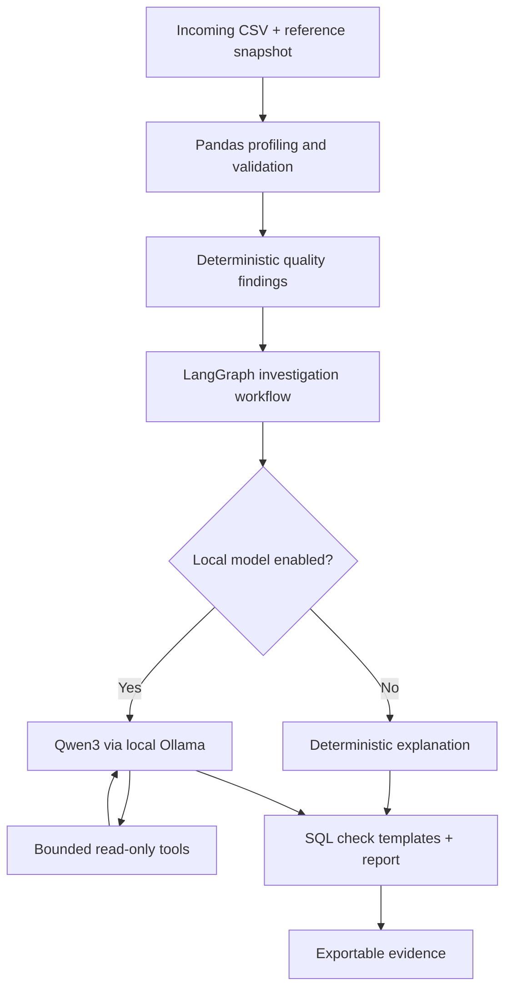

<div align="center">

# SchemaGuard AI

### Data Quality Monitoring & Agent-Assisted Investigation

**Python · Pandas · LangGraph · Streamlit · Qwen3 / Ollama (optional local agent)**

[Live Dashboard](https://schemaguardaiagent.streamlit.app/) · [Source Code](https://github.com/karthikeyansett1/Schemaguard---AI_Agent) · [Features](#features) · [Evaluation](#evaluation) · [Get Started](#getting-started)

</div>

---

## Overview

A data pipeline can finish successfully and still deliver unusable information: invalid values, missing identifiers, duplicate records, and schema or distribution changes can undermine downstream reporting and modeling.

**SchemaGuard AI** is a data-quality triage workbench that compares an incoming dataset with a reference snapshot, runs reproducible validation checks, and produces evidence-backed findings. A LangGraph investigation workflow can optionally use a **locally running Qwen3 model** to select read-only tools and explain results. Detection remains deterministic; the model does not invent the underlying quality metrics.

> **Deployment boundary:** The public Streamlit deployment exposes the Python-based dashboard and deterministic features. Qwen3-powered tool calling requires running the application locally with Ollama; it is **not** available through the public demo without separately hosted model infrastructure.

## Features

| Area | Capability |
|---|---|
| Overview | Dataset health indicators, issue summaries, and visualizations |
| Quality Monitor | Column profiles, missingness, anomalies, and snapshot comparison |
| AI Investigator | LangGraph workflow; optional local model with bounded read-only tool calls |
| Evaluation Lab | Controlled corruption-injection benchmark with clean controls |
| SQL Workspace | Generated SELECT-based checks and limited template validation |
| Reports | Exportable findings, benchmark evidence, and investigation traces |

The checks target supported data-quality conditions, including invalid quantities and amounts, duplicate keys, missing identifiers, unexpected categories, and changes relative to a reference dataset. Rule coverage is configuration-specific, not universal schema inference.

## Architecture



### Model-accessible tools

| Tool | What it returns |
|---|---|
| `get_quality_findings` | Rule violations, affected columns, and severity |
| `get_column_profile` | Column types, missingness, and uniqueness |
| `get_baseline_evaluation` | Results and limitations of the synthetic benchmark |

The model chooses which available tool to call; Python supplies the computed data. Tool execution is restricted to the defined interface.

## Evaluation

The deterministic rule engine was assessed using a **small synthetic corruption-injection benchmark**:

| Measure | Observed |
|---|---:|
| Injected corruption cases | 20 |
| Cases detected | 18 |
| Injected-case detection recall | **90%** |
| Clean control snapshots | 20 |
| Clean controls flagged | 0 |

Two small null-rate increases fell below the configured alert threshold. The 0/20 clean-control result is **not** evidence of a zero false-positive rate on arbitrary datasets.

Three directed local model prompts were also manually observed selecting `get_quality_findings`, `get_column_profile`, and `get_baseline_evaluation`, respectively. That demonstration is not a statistically meaningful model tool-selection benchmark.

Re-run the deterministic benchmark:

```bash
python scripts/export_benchmark.py
```

The metrics describe the Python validation rules on constructed cases, **not** language-model accuracy or production reliability.

## Getting started

**Requirements:** Python 3.12 recommended. The deterministic dashboard works without a model or API key.

```bash
git clone https://github.com/karthikeyansett1/Schemaguard---AI_Agent.git
cd Schemaguard---AI_Agent
python3 -m venv .venv
source .venv/bin/activate  # Windows PowerShell: .venv\Scripts\Activate.ps1
python -m pip install -r requirements.txt
python -m streamlit run app.py
```

Open the address Streamlit prints. Use the included `sample_reference.csv` and `sample_corrupted.csv` to explore comparison behavior.

### Optional: run the model-powered investigator locally

Install [Ollama](https://ollama.com/), then download and start the Qwen3 model:

```bash
ollama pull qwen3:8b
ollama list
```

Ensure Ollama is running and reachable from your local application. Enable the local model in **AI Investigator** and inspect the actual tool-call trace to verify tool execution. The public Streamlit Cloud app cannot access your laptop's `localhost` model endpoint.

### Automated tests

```bash
python -m pytest -q
```

## Public demo

**[Open the Streamlit dashboard](https://schemaguardaiagent.streamlit.app/)**

The public deployment is intended for demonstrations of deterministic analytics, synthetic data exploration, quality reports, and applicable SQL checks. Model-powered local investigations are a separate optional setup. Availability of the hosted URL should be verified in a normal browser; a URL alone is not proof of continuous uptime.

## Repository map

```text
app.py                 Streamlit application
engine.py              Deterministic data-quality engine
agent.py               Local agent support
graph_agent.py          LangGraph investigation workflow
sample_reference.csv   Reference sample
sample_corrupted.csv   Corrupted sample
scripts/               Benchmark export utilities
tests/                 Automated checks
docs/                  Evaluation and documentation
```

## Limitations and responsible use

- Rules and thresholds are tailored to supported dataset structures; results may not transfer to unrelated schemas.
- Benchmark cases are synthetic and limited in number.
- SQL generation and template-shape checks are **not** a full SQL parser or an authorization boundary.
- LLM explanations can be imperfect and should be checked against recorded tool outputs.
- The public app processes uploads in its application environment. Avoid confidential, regulated, or identifiable datasets.
- No publicly hosted Qwen3 inference endpoint is supplied with the current deployment.

SchemaGuard AI is an educational engineering prototype demonstrating deterministic validation, bounded agent tools, and traceable data-quality investigations.
