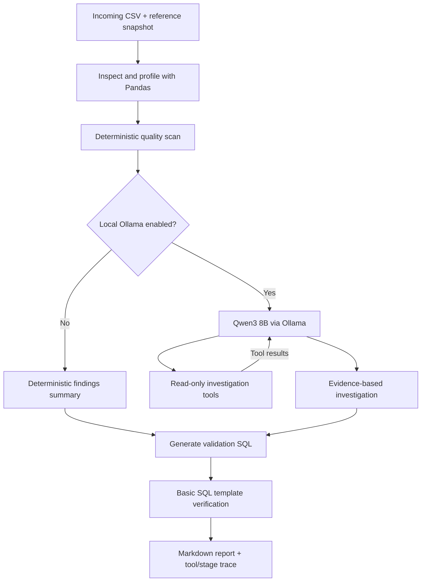

<div align="center">

# ◈ SchemaGuard AI

### Agentic Data Quality & Observability Command Center

**Detect pipeline data issues · Investigate with LangGraph and Qwen3 · Generate validation SQL · Evaluate detection performance**

[](https://www.python.org/)
[](https://github.com/langchain-ai/langgraph)
[](https://ollama.com/)
[](https://streamlit.io/)
[](https://github.com/karthikeyansett1/Schemaguard---AI_Agent)

[**Source Repository**](https://github.com/karthikeyansett1/Schemaguard---AI_Agent) · [**Architecture**](#architecture) · [**Evaluation**](#evaluation-and-results) · [**Run Locally**](#quick-start) · [**Deployment**](#public-deployment)

</div>

> **Public demo:** schemaguardaiagent.streamlit.app **Real Qwen3 agent investigations require local Ollama** in the supplied setup.

## The problem

A data pipeline can succeed technically and still deliver bad data: unexpected schema changes, invalid business values, duplicate identifiers, increased missingness, or distribution shifts. Such issues can silently break dashboards and degrade downstream machine-learning models.

**SchemaGuard AI** is a local-first prototype that compares an incoming CSV against a reference snapshot, surfaces evidence-backed quality findings, and uses a **LangGraph-controlled investigation workflow** to produce interpretable remediation guidance and SQL check templates.

This project deliberately separates **deterministic detection** from **LLM-generated interpretation**: Python computes the findings, while the optional language model selects read-only tools and explains their results.

## Command Center interface

The responsive Streamlit interface provides six workspaces:

| Workspace | Purpose |
|---|---|
| **Overview** | Dataset KPIs, quality status, and monitoring visualizations |
| **Quality Monitor** | Column profiles, completeness, anomalies, and data previews |
| **AI Investigator** | LangGraph investigations, Qwen3 tool selection, execution trace, and report |
| **Evaluation Lab** | Synthetic corruptions, missed cases, and detection metrics |
| **SQL Workspace** | Generated validation checks and controlled local read-only SQL |
| **Reports** | Export investigation and evaluation evidence |

**Add your actual UI screenshots before publishing the finished portfolio:**

1. Save screenshots as `docs/screenshots/overview.png`, `docs/screenshots/ai-investigator.png`, and `docs/screenshots/evaluation-lab.png`.
2. Uncomment the image lines below after those files exist:


## Features

- **Data profiling:** column names, inferred types, missing counts, unique counts, and sample-level health summaries.
- **Data-quality triage:** configured checks for invalid quantities/amounts, missing identifiers, unexpected categories, duplicate keys, and snapshot-level changes.
- **Reference comparison:** incoming datasets are checked against a baseline to detect certain schema and distribution changes.
- **Agentic investigation:** a compiled LangGraph workflow routes to either deterministic analysis or a local Qwen3 8B agent with bounded, read-only tools.
- **Explainability:** inspect executed tool calls, arguments, abbreviated tool results, model status, and graph stages.
- **SQL validation:** generate SELECT-based validation templates and perform limited template-shape checks (not a production SQL security guarantee).
- **Reproducible benchmarking:** export results from 20 injected corruption scenarios and 20 clean control snapshots.
- **Local-first privacy design:** raw CSV rows are not intentionally sent to the LLM; it receives bounded profiling summaries and tool outputs. Do not treat this as a guarantee of regulatory compliance.

## Architecture



### Tools exposed to the model

| Tool | Returns |
|---|---|
| `get_quality_findings` | Detected rule violations, affected columns, and severities |
| `get_column_profile` | Column-level types, missingness, and uniqueness |
| `get_baseline_evaluation` | Synthetic benchmark recall and clean-control alert rate |

The model chooses a tool; **the Python tool supplies the underlying numbers**. This is not an unrestricted code-execution agent. The graph continues to SQL template generation and reporting after investigation.

### Example: observed local Qwen3 tool call

For the sample corrupted data, one captured local investigation returned:

```json
{
  "round": 1,
  "tool": "get_quality_findings",
  "arguments": {},
  "result_preview": "[{\"code\": \"invalid_quantity\", \"column\": \"quantity\", \"severity\": \"high\", \"detail\": \"45 impossible quantities\"}]"
}
```

In two other **directed** manual prompts, the model selected `get_column_profile` and `get_baseline_evaluation` respectively. This is **3 successful selections out of 3 prompts tested**, not an estimate of general tool-selection accuracy. Real runs may vary.

## Evaluation and results

The deterministic rule engine was evaluated on a small **synthetic corruption-injection benchmark**:

| Measure | Observed result |
|---|---:|
| Injected corruption cases | 20 |
| Corruption cases flagged | **18** |
| Injected-case detection recall | **90%** |
| Clean control snapshots | 20 |
| Clean control snapshots flagged | **0** |
| Clean-snapshot flag rate | **0%** |

Two small null-rate increases were missed under the configured threshold. Threshold tuning can change the sensitivity/false-positive trade-off.

**Evaluation scope:** These metrics evaluate the **Python detection rules** on constructed scenarios, **not LLM accuracy or real-world production performance**. The 0/20 clean-control result is not proof of a zero false-positive rate on arbitrary datasets.

Regenerate the benchmark artifacts:

```bash
python scripts/export_benchmark.py
```

Generated outputs are stored under `docs/evaluation/` (including `metrics.json`; exact files depend on the exporter version). The Evaluation Lab provides a visual breakdown.

## Quick start

### Requirements

- Python **3.12** recommended
- macOS, Linux, or Windows for the deterministic dashboard
- Optional: [Ollama](https://ollama.com/download) and enough local memory to run `qwen3:8b` for model-powered investigation

### 1. Clone and install

```bash
git clone https://github.com/karthikeyansett1/Schemaguard---AI_Agent.git
cd Schemaguard---AI_Agent
python3 -m venv .venv
source .venv/bin/activate   # Windows PowerShell: .venv\Scripts\Activate.ps1
python -m pip install -r requirements.txt
```

### 2. Start the app without an LLM

```bash
python -m streamlit run app.py
```

Open the local address shown by Streamlit (usually `http://localhost:8501`). By default, a built-in synthetic dataset can be used without uploading files. To compare an intentionally corrupted snapshot, choose `sample_corrupted.csv` as incoming and `sample_reference.csv` as reference.

### 3. Enable local Qwen3 8B (optional)

In a separate terminal, install and start Ollama, then download the model:

```bash
ollama pull qwen3:8b
ollama list
```

Ensure the Ollama service is running and reachable at `http://localhost:11434` (opening the Ollama desktop app may start the service). In **AI Investigator**, enable the Ollama option, run the investigation, and expand the **LLM tool trace** to inspect actual tool use.

Try these directed prompts:

```text
Call get_quality_findings and summarize verified violations and their ETL impact.
Call get_column_profile and report data types and missing-value counts.
Call get_baseline_evaluation and explain the synthetic recall and limitations.
```

**Important:** The availability of an LLM response alone does not prove tool use—check the recorded tool events. If the model is unavailable, the application should make that status clear; deterministic features do not require Ollama.

### 4. Run tests

```bash
python -m pytest -q
```

Tests are useful after code changes and before publishing; they are **not** required each time you launch the dashboard.

## Public deployment

This project is designed for a **$0 API-cost public demo** with a practical limitation: Streamlit Community Cloud can host the Python analytics app, but it cannot reach your laptop's `localhost` Ollama server.

1. Push the repository to GitHub.
2. Visit [Streamlit Community Cloud](https://share.streamlit.io/) and create an app from this repository.
3. Select `main`, `app.py`, and Python 3.12 if offered.
4. Deploy without an OpenAI key or other paid API credentials.
5. Verify uploads, deterministic investigation, SQL checks, and the Evaluation Lab in a private browser window.
6. Add your **actual** Streamlit URL to the top of this README after successful deployment.

**Public demo vs. local agent:** Public visitors can use the deterministic analysis features; local Qwen3 tool calling requires installing Ollama and running the app on their own machine. This repository does **not** claim to host a publicly accessible model endpoint.

## Repository structure

```text
.
├── app.py                    # Streamlit Command Center UI
├── assets/
│   └── command_center.css   # Custom UI styling
├── .streamlit/
│   └── config.toml          # Theme configuration
├── engine.py                 # Deterministic quality checks and benchmark
├── graph_agent.py            # LangGraph graph and optional Ollama tools
├── requirements.txt
├── sample_reference.csv
├── sample_corrupted.csv
├── scripts/
│   └── export_benchmark.py
├── docs/
│   ├── TOOL_DEMO.md
│   ├── DEPLOY.md
│   ├── evaluation/
│   └── screenshots/         # Add real screenshots here
└── tests/
```

## Limitations and future work

- **Small synthetic benchmark:** expand coverage to unseen real-world data and additional corruption families before claiming robust detection.
- **LLM fallibility:** text explanations can still overgeneralize or recommend invalid constraints; compare recommendations with the exact configured validation rules.
- **Rule scope:** current checks reflect the sample `orders` schema; they are not automatically inferred for arbitrary business datasets.
- **SQL safety:** the template-shape check is not a general SQL parser or a production-grade authorization boundary.
- **Data handling:** uploaded CSVs are processed by the app process; don't upload regulated, confidential, or sensitive datasets to an unaudited public demo.
- **Scale:** the app is a bounded prototype, not a distributed data-quality platform.
- **Cloud LLM:** no hosted Qwen3 deployment is included; a public inference service would require additional security, quotas, and cost controls.

Potential extensions: BigQuery connector, configurable validation contracts, model-call evaluation datasets, LangSmith trace instrumentation, Docker-based deployment, and guarded hosted model inference.

## Why this project

SchemaGuard is designed to demonstrate **agent orchestration, deterministic tool design, traceable decisions, evaluation discipline, and an accessible frontend**. It can also serve as a teaching example for the difference between a fixed LangGraph workflow and genuine LLM-directed tool calling.

---

<div align="center">

Built with **Python · Pandas · SciPy · LangGraph · Ollama/Qwen3 · Streamlit · Plotly**

[GitHub repository](https://github.com/karthikeyansett1/Schemaguard---AI_Agent)

</div>
